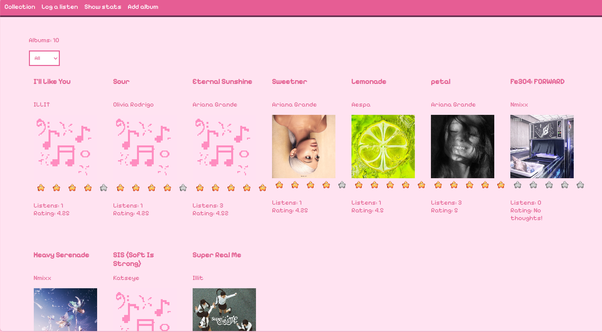
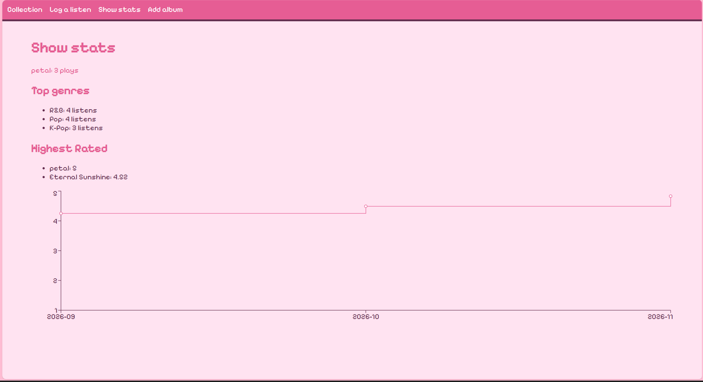
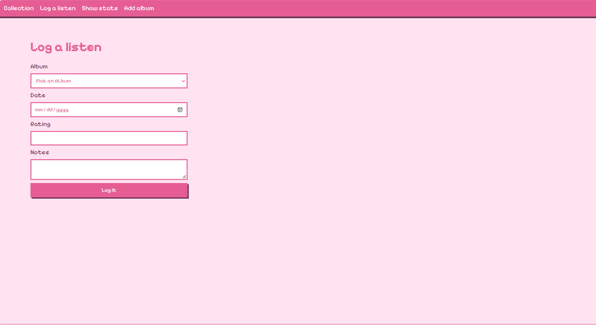
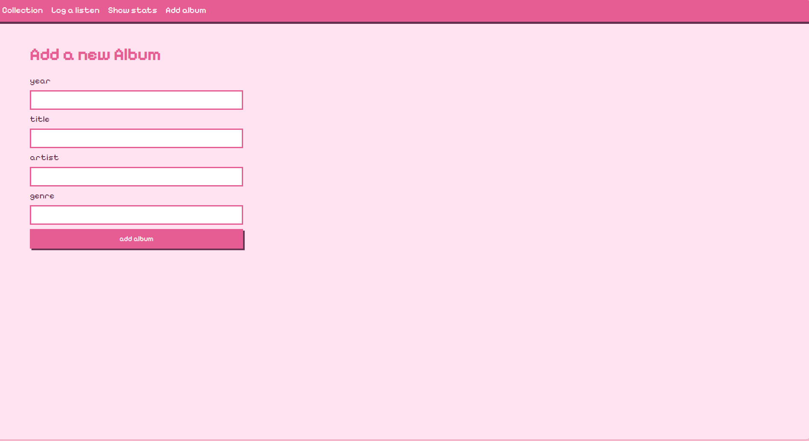

# GroovyLog

[](https://github.com/fannytraore12/GroovyLog/actions/workflows/ci.yml)

A pixel-art music journal for the albums you listen to. Add an album and its cover art is found automatically, log each listen with a rating and a note, and see stats about your taste.



## Features

- **Add albums** with title, artist, genre and year. Cover art is fetched automatically from Apple's iTunes Search API, with a hand-drawn pixel-art placeholder when no cover is found.
- **Log listens** with a date, a 1 to 5 rating and a short note.
- **Browse your collection** as a card grid showing each album's cover, star rating (average of all its listens) and listen count, with a genre filter.
- **Stats dashboard** with a line chart of your average rating month by month, plus top genres, highest-rated albums and your most-replayed album.
- **Loading and error states** so the app tells you when the server can't be reached, and shows the API's validation messages (like "Rating must be between 1 and 5!").

## Screenshots

| Collection | Stats |
|---|---|
|  |  |

| Log a listen | Add an album |
|---|---|
|  |  |

## Tech stack

| Layer | Tools |
|---|---|
| Front end | React, React Router, Recharts, Vite |
| Back end | Node.js, Express (REST API) |
| Database | SQLite via better-sqlite3 |
| Testing | Jest and Supertest (API), Vitest and React Testing Library (components) |
| CI | GitHub Actions |
| External API | Apple iTunes Search API (album covers) |

## How it works

GroovyLog has three layers. The **React front end** shows the pages and sends requests with `fetch`. The **Express API** receives those requests, validates them, runs the SQL, and answers with JSON. The **SQLite database** stores everything in two related tables.

- `albums`: `id`, `cover_url`, `title`, `artist`, `genre`, `year`
- `listens`: `id`, `album_id`, `date`, `rating`, `note`

Each listen points to its album through a foreign key (`listens.album_id` references `albums.id`), so one album can have many listens. The collection and stats pages use `JOIN`, `GROUP BY`, `AVG`, `COUNT` and `HAVING` to combine and summarize those tables.

When you add an album, the API asks the iTunes Search API for its cover. If the lookup finds nothing or fails, the album is still saved with no cover.

## API routes

| Method | Path | What it does |
|---|---|---|
| GET | `/` | Health check, returns `{ "status": "ok" }` |
| GET | `/albums` | All albums with average rating and listen count. Optional `?genre=Pop` filter |
| GET | `/albums/:id` | One album with its stats, or 404 |
| POST | `/albums` | Add an album (`title` and `artist` required), returns 201, or 400 if invalid |
| GET | `/listens` | All listens with their album title, newest first |
| POST | `/listens` | Log a listen. Checks the rating is 1 to 5 (400) and the album exists (404) |
| GET | `/stats` | Monthly average ratings, top genres, highest-rated albums and most-replayed album |

## Run it locally

You need Node.js 22 or newer. Use two terminals.

**Terminal 1: the API (port 3000)**

```bash
npm install
npm run dev
```

**Terminal 2: the React app (port 5173)**

```bash
cd client
npm install
npm run dev
```

Open <http://localhost:5173>. The database file (`src/server/groovylog.db`) is created automatically the first time the API starts.

> **Note:** newer versions of npm may ask you to approve install scripts. `better-sqlite3` needs its install script to build, so approve it if prompted.

### Sample data (development only)

`src/server/seed.js` fills the database with a few sample albums and listens. It is for development only, and it can wipe existing data, so don't run it on a database you care about.

## Run the tests

```bash
# API tests (Jest and Supertest), from the project root
npm test

# Component tests (Vitest and React Testing Library)
cd client
npm test
```

The API tests run against a temporary in-memory database, so they never touch your real data.

## Tests and CI

- **9 API tests** (Jest and Supertest) cover the routes, including validation: missing title returns 400, unknown album returns 404, a rating outside 1 to 5 returns 400.
- **2 component tests** (Vitest and React Testing Library) check that `AlbumCard` shows its data and its "no rating" fallback.
- **GitHub Actions** runs both suites on every push and pull request.

## Project structure

```
GrooveLog/
├── src/
│   ├── app.js          # Express app and routes
│   ├── server.js       # Starts the server on port 3000
│   └── server/
│       ├── db.js       # Database connection and tables
│       └── seed.js     # Sample data (development only)
├── client/             # React app (Vite)
│   └── src/
│       ├── components/ # AlbumCard
│       └── pages/      # Collection, LogListens, Stats, AddAlbum
├── test/               # API tests
└── .github/workflows/  # CI
```

## Roadmap

- Edit and delete albums and listens
- User accounts, so each person has their own journal
- Photo uploads for listens
- Deploy a live demo
